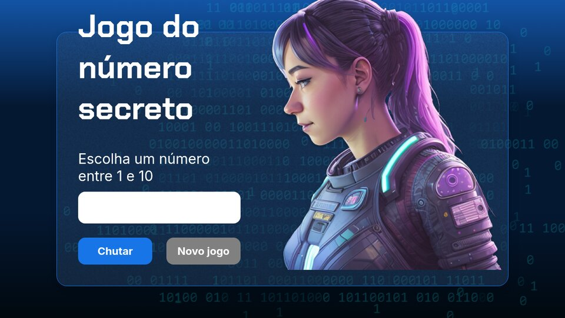

# 🔢 Jogo do Número Secreto

Adivinhe o número secreto entre 1 e 10. A cada chute o jogo diz se o número é **maior** ou **menor** e **lê as mensagens em voz alta** com a Web Speech API.

🔗 **Jogar:** https://jogo-do-numero-secreto-henna-gamma.vercel.app

## Funcionalidades

- Dicas de "maior" / "menor" a cada tentativa
- Contador de tentativas no final da partida
- Narração das mensagens em português (`speechSynthesis`, pt-BR)
- Não repete números já sorteados até esgotar o intervalo
- Botão de novo jogo

## Tecnologias

HTML5 · CSS3 · JavaScript (vanilla) · Web Speech API

## Como rodar

Basta abrir o `index.html` no navegador.

---

Projeto feito durante a formação de lógica de programação da Alura.
